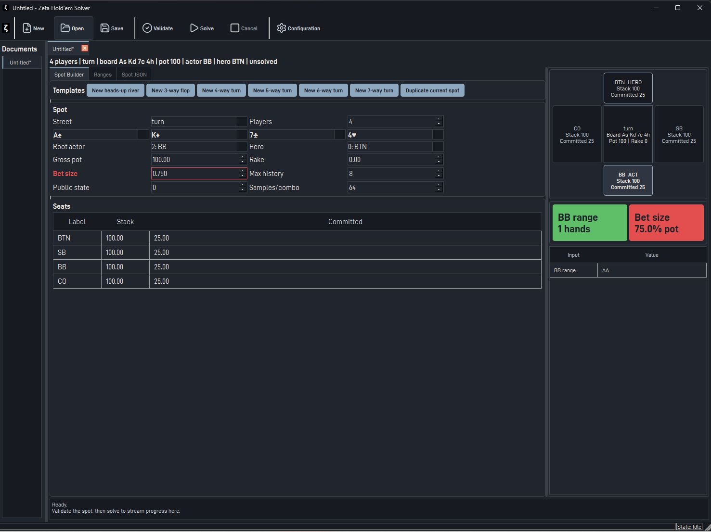
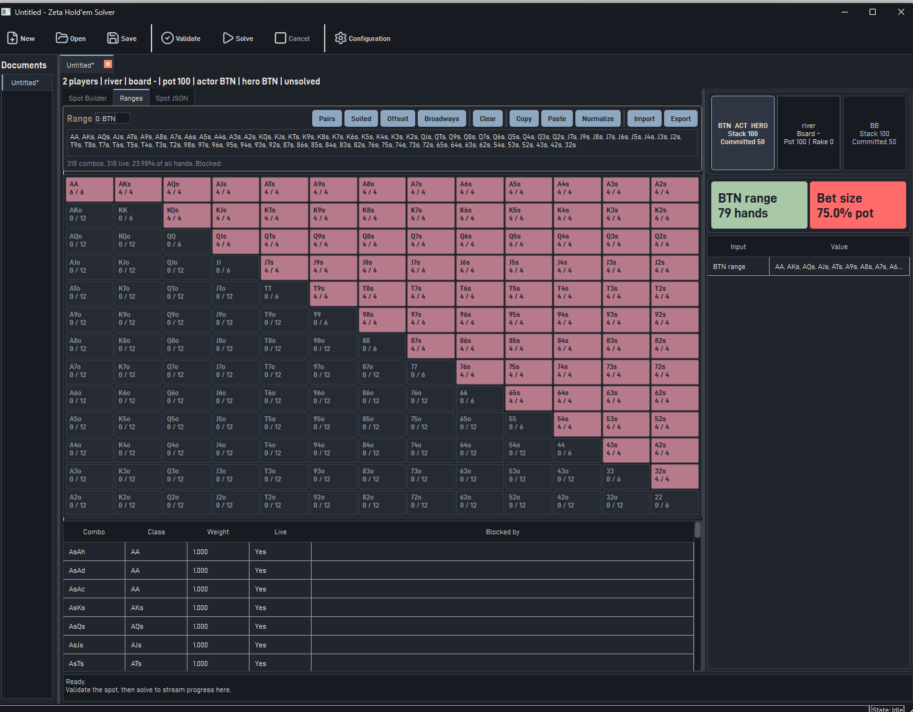
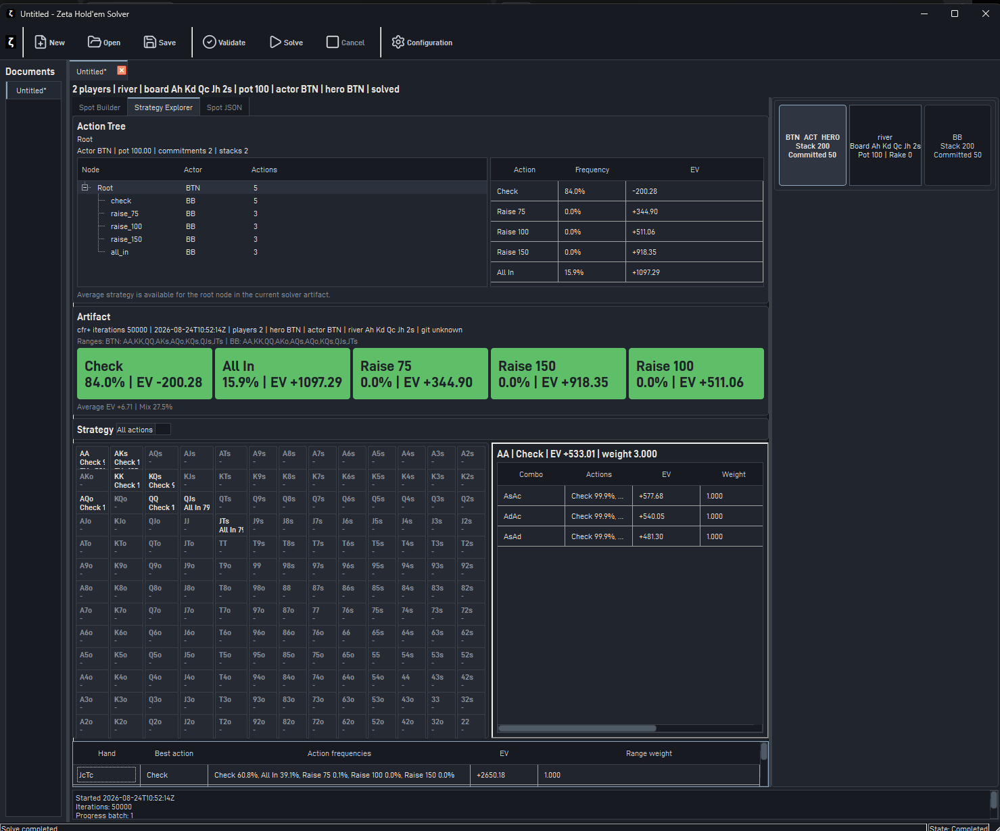

# Zeta

Zeta is a C++ card-game engine and solver project.

## Disclaimer

Zeta is an independent research and software project developed for
educational and experimental purposes. It is not intended to provide
financial, investment, gambling, or other professional advice. The
software is provided "as is" without warranty.

## Generic card game engine

The core library provides the generic card representation, deck traits, suit/rank types, and bit-mask operations that
can be used to implement trick taking card games. The Texas Hold'em module has its own representations and algorithms.

- [Core structures](doc/core/core_structures.md)

## Texas Hold'em

The Hold'em module has a lookup-based 7-card evaluator, a PokerStove-style range parser, and a CFR+ postflop solver with a CLI and a Qt UI.

- [Core algorithms](doc/holdem/core_algorithms.md) and the [implementation deep dive](doc/holdem/core_algorithms_deep_dive.md)
- [Core structures](doc/holdem/core_structures.md)
- [Lookup-based 7-card evaluator](doc/holdem/post_flop_hand_evaluator.md)
- [PokerStove-compatible range parser](doc/holdem/range_parser.md)
- [River terminal evaluator](doc/holdem/terminal_evaluator.md)
- [zeta-solve CLI](doc/holdem/cli_usage.md)
- [Hold'em solver UI user guide](doc/holdem/ui/user_guide.md)
- [Node locking](doc/holdem/node_locking.md)
- [Hold'em solver next steps](doc/holdem/plans/next_steps.md)

### GTO postflop analyser

Zeta includes a combo-vectorised CFR+ solver for Hold'em postflop analysis: heads-up
**flop**, **turn**, and **river** spots, and multiway (up to 7 players) **river** spots. It
is exposed through both the `zeta-solve` CLI and the solver UI. Node locks fix part of a
player's strategy at chosen decisions (for the whole range or named hands) and re-solve,
so you can see how the other player exploits that play; see the
[node locking guide](doc/holdem/node_locking.md). River leaves are
evaluated by the terminal evaluator documented in
[River terminal evaluator](doc/holdem/terminal_evaluator.md), which currently
implements:

- board-specialized river caches (`river_terminal_cache`)
- per-player reach indices with blocker-corrected mass accounting
- dedicated heads-up evaluator with exact showdown and fold kernels
- exact N-way terminal-state evaluation for explicit showdown/fold states
- side-pot and rake-aware terminal-state payoff distribution
- multi-threaded solving (`worker_threads`): terminal leaves, per-hand passes, setup and extraction, bit-identical for any thread count

| Solver overview | Range editor | Strategy Explorer |
|---|---|---|
|  |  |  |

The roadmap from here to a complete analysis tool is in [next_steps](doc/holdem/plans/next_steps.md).

#### Benchmark baseline (solver)

`zeta-bench-holdem-solve` times complete solves on the production solver. Each
benchmark's argument is `worker_threads`, and each reports where a solve's time goes:
`graph_build_ms`, `setup_ms` (river caches, reach indices, labels and locks),
`extraction_ms`, and `cfr_ms_per_iteration`. Its iteration and terminal-evaluation
rates are over CFR time only.

```sh
cmake --build build --target zeta-bench-holdem-solve-json
```

Medians of three runs, Release (MSVC), 16 logical CPUs, 2026-11-20. The benchmarks run
only a few iterations, so a whole solve is mostly setup and extraction; the CFR time
per iteration is the figure that scales to real solves of hundreds of iterations.

| Benchmark | Spot (nodes / leaves) | Iterations | Solve ms, 1 / 4 / 8 / 16 threads | CFR ms per iteration, 1 / 4 / 8 / 16 threads |
|---|---|---:|---:|---:|
| `BM_SolveRiverHeadsUp` | Heads-up river (75 / 49) | 50 | 59.6 / 33.1 / 29.1 / 27.9 | 1.10 / 0.59 / 0.52 / 0.49 |
| `BM_SolveRiverThreeWay` | Three-way river (25 / 13) | 10 | 49.4 / 28.4 / 26.9 / 32.2 | 3.76 / 2.21 / 2.14 / 2.59 |
| `BM_SolveTurnHeadsUp` | Heads-up turn (2,085 / 1,302) | 10 | 369 / 320 / 266 / 212 | 26.8 / 21.6 / 17.1 / 12.9 |
| `BM_SolveFlopHeadsUp` | Heads-up flop (31,124 / 21,268) | 2 | 2,085 / 1,007 / 909 / 819 | 447 / 189 / 149 / 129 |
| `BM_SizeFlopRealistic` | Memory pre-flight for a realistic flop tree, no solve | - | - | - |

At 16 threads the flop solve splits into 43 ms graph build, 276 ms setup, 259 ms of CFR
(2 iterations) and 207 ms extraction; setup is now its largest serial cost. The small
rivers stop scaling at about 8 threads, where there is too little work per pass to share.

### Evaluator benchmark summary

Recent release benchmark results for the chunked restricted-quinary evaluator:

| Environment | Random 7-card median | Adversarial median | Table data |
|---|---:|---:|---:|
| WSL Clang release | ~7.12 ns/eval | ~7.41 ns/eval | ~337 KiB |
| MSVC release | ~9.19 ns/eval | ~9.39 ns/eval | ~337 KiB |

The evaluator uses a direct flush lookup plus a dense restricted-quinary non-flush table, avoiding 21-subset 5-card enumeration.

Latest Google Benchmark summary from `zeta-bench-holdem-evaluator` on Release WSL Clang:

| Benchmark | Throughput | CPU time | Purpose |
|---|---:|---:|---|
| `BM_DenseTableLookup` | ~674.0M/s | ~73.0 us / 49,205 slots | Full dense non-flush rank-table scan |
| `BM_FullEvaluateRandom` | ~133.5M/s | ~7.49 ns/eval | Random 7-card evaluator path |
| `BM_FullEvaluateAdversarial` | ~144.4M/s | ~6.93 ns/eval | Repeated adversarial 7-card patterns |
| `BM_EvaluateFromMasksRandom` | ~154.7M/s | ~6.46 ns/eval | Evaluator from precomputed suit/rank masks |
| `BM_IsolatedQuinaryIndex` | ~187.2M/s | ~5.34 ns/index | Non-flush quinary index from masks |
| `BM_QuinaryIndexFromLayers` | ~265.8M/s | ~3.76 ns/index | Quinary index from precomputed rank layers |
| `BM_MasksOnly` | ~621.7M/s | ~1.61 ns/hand | Card mask to suit/rank masks |
| `BM_MasksFlushCheck` | ~472.6M/s | ~2.12 ns/hand | Mask construction plus flush detection |
| `BM_MasksFlushIndex` | ~153.7M/s | ~6.51 ns/hand | Mask construction plus flush/non-flush indexing |
| `BM_DenseLookupOnly` | ~668.4M/s | ~1.50 ns/lookup | Dense non-flush table lookup only |
| `BM_EvaluateAllSevenCards` | ~156.1M/s | ~6.41 ns/eval | Exhaustive 52 choose 7 evaluator run |

These numbers show the hot path is the non-flush restricted-quinary index, not the dense rank-table lookup.

## Build profiles

Use the CLion CMake profiles for local builds:

- `Debug-WSL (Clang)`
- `Release-WSL (Clang)`
- `Debug-Visual Studio`
- `Release-Visual Studio`
